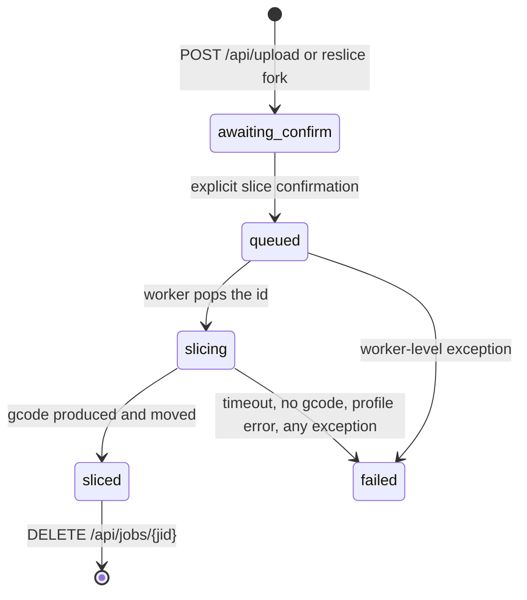

# Architecture

print-portal is one container: a FastAPI app that slices an uploaded model with the OrcaSlicer CLI
and hands the resulting `.gcode` to Moonraker over HTTP. No database, no shared filesystem with the
printer host (`AGENTS.md`, `app/main.py` module docstring).

**Two states are documented.** **A** = `develop` @ `dc92ca1` (this worktree). **B** = the uncommitted
`ergo/20261022T123034Z-import-name` branch, read from a read-only snapshot of the live tree. The historical upload pipeline below describes those states; the current
reslice path is described separately below. The seed contents and the preset behaviour differ — see
[presets.md](presets.md) and the `data/` table at the end.

## Components

| Module | Responsibility |
|---|---|
| `app/main.py` | Routes, job storage, the slicing worker thread, printer resolution. `app = FastAPI(...)`, `lifespan` starts the worker (`main.py:725-732`). |
| `app/config.py` | The only module that reads `os.environ`. `load_config()` → frozen `Config` dataclass (`config.py:123`). |
| `app/profiles.py` | Preset import, normalisation, derived options preset, machine/process compatibility. See [presets.md](presets.md). |
| `app/printers.py` | Printer store (`printers.json` + Fernet-encrypted keys), the env seed row, pairing validation. |
| `app/moonraker.py` | Moonraker HTTP client; maps transport/HTTP failures onto `MoonrakerError` subclasses carrying `http_status` (`moonraker.py:46-69`). |
| `app/threemf.py` | Strictly inspects native 3MF layouts and plate selectors; reads identity and rewrites a job-local copy that names local presets. |
| `app/supportfins.py` | Wraps the bundled `app/support_fins.mjs`: `available()`/`unavailable_reason()`, and `fin_model()` — one `node` run with `--json`, bounded by `SUPPORT_FINS_TIMEOUT`, serialised by `_RUN_LOCK`, failures as `SupportFinsError`/`SupportFinsUnavailable`. |
| `app/preview.py` | Reads a job's 3MF/STL/OBJ geometry for the rotatable pre-slice preview (`read_scene`), capped by `MAX_TRIANGLES` (450 000) and `MAX_BYTES` (32 MiB). |
| `app/shot.py` | Paints front and side PNGs when the finned file is over that byte cap, up to 150 MiB. The slice still uses the original file. |
| `app/archives.py` | Safely extracts ordered model members from containers and bounds strict 3MF archive preflight. |
| `app/gcode.py` | Parses the slicer's gcode header for grams/time/layers (`MAX_HEAD_BYTES = 2_000_000`). |
| `app/index.html` | The whole UI, inline CSS/JS. Served by `GET /`. |

## Request flow

```mermaid
sequenceDiagram
    participant B as Browser
    participant F as FastAPI (main.py)
    participant Q as queue.Queue + worker thread
    participant S as OrcaSlicer CLI
    participant D as data/ + SLICED_DIR
    participant M as Moonraker

    B->>F: POST /api/upload (multipart file)
    F->>F: reject_oversize → suffix check → require_selection()
    F->>D: private upload scratch; inspect and expand plates/members
    F->>F: ordered prepare: identity rewrite + per-job snapshot/pins
    F->>D: atomic publish of staged jobs under STAGE_LOCK
    F-->>B: 200 {"id","status":"awaiting_confirm", "jobs?", "jobGroup?"}
    B->>F: POST /api/jobs/{jid}/slice (options, fins, resize)
    F->>D: re-pin options, apply resize/fins, job.json {"status":"queued"}
    F->>Q: job_queue.put(jid)
    F-->>B: 200 {"id","status":"queued","queue_position"}
    Q->>S: orca-slicer --load-settings <machine>;<process> --load-filaments <filament> --slice <selector>
    S->>D: out/*.gcode + result.json
    Q->>D: move gcode → SLICED_DIR/<jid>/<output_name>.gcode, job.json status=sliced
    B->>F: GET /api/jobs (poll)
    B->>F: POST /api/jobs/{jid}/print
    F->>M: printer_status() → upload → start_print
    F-->>B: {"started": true, "remote_file": ...}
```

### How a batch and its jobs run

1. `api_upload` checks size, suffix and `require_selection()` before staging. STL/OBJ use the regular
   singleton path. ZIPs and 3MFs stream into private `.upload-*` scratch, with bounded reads.
2. `archives.extract_models` extracts ZIP or loose-3MF printable members in deterministic order.
   `threemf.inspect_layout` strictly validates native packages and their declared contiguous 1-based
   plate selectors. A native package is never split into its component models; absent plate
   declarations mean one generic whole-build job. Nested loose wrappers and expansions beyond 64 final
   jobs are rejected. A ZIP containing a multi-plate project yields a single flattened batch.
3. Each expanded job gets its own complete model copy. `_prepare_models` processes all copies in
   flattened order under `DERIVED_LOCK`: native 3MF identity is matched and rewritten, then each
   job receives its own snapshot, effective preset files and hashes. `_await_prepare` joins its
   worker even on request cancellation, so cleanup cannot race ongoing writes. The original outer
   container is retained with the first job, using `archive/` if its basename collides with a model.
4. After all preparations succeed, `_publish_upload_batch` renames and records every job under
   `STAGE_LOCK`; any failure rolls back all already-published members. Each explicit plate gets
   `plate: {index, name, count}`. If and only if there is more than one final job, every member also
   persists the same `jobGroup: {id, name, job_ids}` as durable original-membership provenance.
   Singleton envelopes remain unchanged. Members are staged as `awaiting_confirm` and must each be
   confirmed; listings remain flat and deleting one member does not change another's descriptor.
5. The worker claims the individually queued job. `run_slice` verifies job-owned pin hashes and
   copies effective settings to a private temporary directory before launching:

   ```text
   <ORCA_BIN> --datadir <ORCA_DATADIR>
              --load-settings <pinned machine>;<pinned process>
              --load-filaments <pinned filament>
              --slice <plate.index or 0> --outputdir <job>/out <full input>
   ```

   Positive plate selectors are validated and passed unchanged; legacy/generic jobs use `0`.
   The subprocess receives only `PATH`, `HOME=<data>/home`, `QT_QPA_PLATFORM=offscreen`,
   `DISPLAY=""`, `LC_ALL=C.UTF-8` and `TMPDIR=<data>/tmp`; it does not inherit `MOONRAKER_API_KEY`.
   Both process and available `result.json` must succeed and exactly one G-code file must exist.
   Only then is it moved to `SLICED_DIR/<jid>/<output_name>.gcode` and the job marked `sliced`.
6. `POST /api/jobs/{jid}/print` separately checks the printer is ready and idle, then uploads and
   starts the print. Slicing itself never prints.

### Job state



`ACTIVE_STATUSES = ("queued", "slicing")` (`main.py:65`). Reslice creates a new staged child rather than
rewriting a terminal state. `prune()` keeps the `KEEP_JOBS` newest finished job directories and never removes an
active one (`main.py:710-722`).

### Staged jobs (support fins and reslice)

Every successful upload is staged with `status: "awaiting_confirm"`, and `support_fins` on the upload form
is ignored. Support fins run at slice time when requested. `POST /api/jobs/{jid}/slice` performs the only
`awaiting_confirm → queued` transition, under `STAGE_LOCK`, so a double click is a 409 rather than a
second queue entry. The 3MF is prepared (`prepare_3mf`) *before* finning, because the CLI's output
carries no OrcaSlicer identity metadata; the rewritten copy is then deleted, so a finned job has
`slicer_input: None` and `threemf["rewrite"] == "discarded"` with an explanatory note.

Because `awaiting_confirm` is absent from `ACTIVE_STATUSES`, such a job lists and deletes like a
finished one but is excluded from age pruning via PRUNE_KEEP_STATUSES, including while a preview dialog is open. The worker does not see a staged job until it is queued.
`GET /api/jobs/{jid}/preview` serves its geometry through `preview.read_scene` (stdlib `zipfile` +
`ElementTree`), which is also why the preview cannot drift from the file that will be sliced.

### Reslice children

`POST /api/jobs/{source}/reslice` copies the source's retained canonical model into a new job's
working upload and baseline. A request UUID makes retries for that source idempotent while the child
exists. Source status, G-code and print metadata are not transferred or changed. ZIP uploads use the
selected model; finned geometry and earlier manual scaling are retained, whereas source CLI
orientation and auto-fit are recalculated. A child retains its source `plate` selector but not the
original upload `jobGroup`; it can outlive the source. Staged children can be
resumed or deleted, are excluded from age pruning, and are also included in bulk deletion. Finished
jobs are subject to `KEEP_JOBS`; pruning removes job directories, not the separate sliced-output
copy. Active jobs and print uploads are protected from deletion and pruning.

A child starts with source preset paths and slicing options, not historical preset contents. Local
settings and geometry edits use a revision; stale operations fail rather than overwrite a newer draft.
Resize modifies only the child, uniformly in millimetres, and reset restores its baseline. Preview
parsing has byte, expanded ZIP, triangle and component-depth bounds and does not support external
3MF references. For a multi-plate source, whole-scene preview, resizing and fins are rejected before
mutating the job; reset can restore the baseline while still reporting preview unavailable. A failed
preview need not prevent settings-only slicing. On confirmation, the portal
validates the local choices and writes job-owned machine, effective process and filament files with
hashes, plus a prepared 3MF when needed. The worker uses those files rather than the legacy live-profile
fallback. This pins directly loaded files, not the full datadir or embedded project/object overrides.
3MF identity preflight can reject unreadable settings; 3MF and fin children cannot use auto-shrink,
and fin orientation is suppressed. Queueing does not start printing.

### Concurrency

One daemon thread (`worker`) consumes `queue.Queue`; slices are therefore serialised. `DERIVED_LOCK`
protects ordered preparation and effective preset capture, but is released before the slicer launches;
private per-job pins and temporary copies prevent concurrent option saves from changing a running
slice. `STAGE_LOCK` serializes batch publication, job lifecycle changes and revision checks within the
process; it is not a distributed lock.
The worker claims queued jobs once, and print uploads hold an in-memory deletion pin.

## What lives in `data/` vs the image

Both are writable state in the container; only the image half survives a container rebuild.

| Path | Where | Created by | Contents |
|---|---|---|---|
| `/app` | image | `COPY app /app` (`Dockerfile:65`) | the application code |
| `/opt/orca` | image | `Dockerfile:2-19` | OrcaSlicer 2.5.0 AppImage, extracted, with a wrapper that sets `LC_ALL=C` |
| `/opt/orca-datadir` | image (read-only seed) | `COPY presets/datadir /opt/orca-datadir` (`Dockerfile:66`) | **A:** 11 preset files incl. `system/Custom/machine/generic-klipper-0.4.json`. **B (uncommitted):** `system/Custom.json` only, four empty lists |
| `/opt/smoke` | image | `Dockerfile:69-71` | `cube.stl` and `portal-import.orca_printer` for the build-time slice |
| `$DATA_DIR/jobs` | volume | `entrypoint.sh:15`, `main.py:79` | one directory per job: `upload/`, `out/`, `job.json` |
| `$SLICED_DIR` | volume | `main.py:82` | finished gcode, `<jid>/<output_name>.gcode` |
| `$DATA_DIR/home` | volume | `entrypoint.sh:15` | `HOME` for the slicer subprocess (Qt config) |
| `$DATA_DIR/tmp` | volume | `entrypoint.sh:15` | `TMPDIR` for Starlette's spooled uploads |
| `$DATA_DIR/profile.json` | volume | `write_profile_file` (`main.py:391`) | active preset paths, `machine_label`, `options` |
| `$DATA_DIR/printers.json` | volume | `printers.py` store | printer rows incl. pairing; API keys encrypted |
| `$DATA_DIR/secret.key` | volume | `printers.py` store | Fernet key for `printers.json` |
| `$DATA_DIR/orca-datadir` | volume | `entrypoint.sh:16-20` | writable copy of the seed plus every imported preset |

Seeding runs when `.seed-version` in `$ORCA_DATADIR` does not equal `SEED_VERSION`
(`entrypoint.sh:16`). The copy is `cp -R -n` — **no-clobber** — so bumping `SEED_VERSION` only adds
files that are missing; it never rewrites an imported preset.

`data/` is therefore the unit of backup: `profile.json`, `printers.json`, `secret.key` and
`orca-datadir/` are the only state that cannot be rebuilt from the image.
